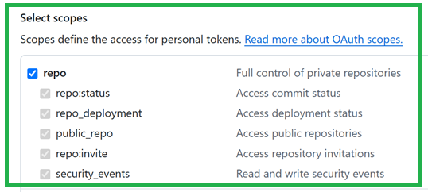

# GithHubMeta

Console app to collect GitHub traffic data into SQLite.

## Run

1. Update `repos.json` with repositories to monitor.
2. Run `dotnet run`.
3. Enter a GitHub token with access to repository traffic data.

## GitHub PAT access

- Recommended: **classic PAT** with `repo` scope.
- If all monitored repositories are public, `public_repo` may be enough.
- Token user must have at least **push/write** access to each monitored repository to read traffic endpoints.
- Fine-grained tokens may return `403 Resource not accessible by personal access token` for traffic APIs.

  

PowerShell example:
`$env:GITHUB_TOKEN="ghp_your_classic_pat_here"`

Data is stored in `github-traffic.db` using entities:

- Repository
- ViewDay (day index table)
- CloneDay (references day index and stores clones + views metrics)
- SyncRun
