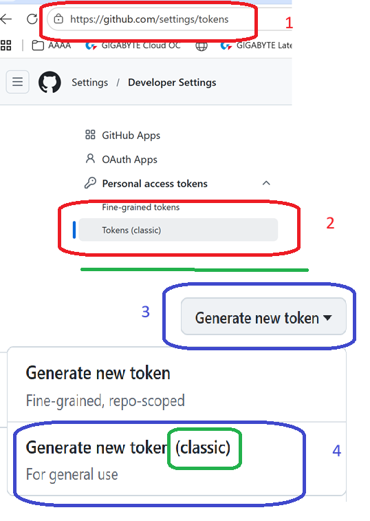

# GithHubMeta

Console and WPF apps to collect and view GitHub traffic data in SQLite.

> Nb: The Date Filter in the WPF app currently doesn't work. *(ToDo)*

## Run

1. Update `repos.json` with YOUR repositories to monitor.
2. Run console sync app: `dotnet run --project .\\GitHubMetaConsole\\GitHubMetaConsole.csproj`.
3. Run WPF viewer app: `dotnet run --project .\\GitHubMetaWPF\\GitHubMetaWPF.csproj`.
4. Enter a GitHub token with access to repository traffic data.
   - 4.1 The token is saved with the WPF app.
   - 4.2 With the WPF you can add and remove repositories including associated data.

## GitHub PAT access

- Recommended: **classic PAT** with `repo` scope.
- If all monitored repositories are public, `public_repo` may be enough.
- Token user must have at least **push/write** access to each monitored repository to read traffic endpoints.
- Fine-grained tokens may return `403 Resource not accessible by personal access token` for traffic APIs.

  
***... Use a Classic PAT***
<br />

  
***...Set PAT scope to `repo` as is required for traffic API access.***

PowerShell example for Console App:

```PS
$env:GITHUB_TOKEN="ghp_your_classic_pat_here"
dotnet run --project .\GitHubMetaConsole\GitHubMetaConsole.csproj
```

Data is stored in `github-traffics.db` using entities:

- Repository
- ViewDay (day index table)
- CloneDay (references day index and stores clones + views metrics)
- SyncRun

> Note: There is a sample database `github-traffics_sample.db`.  
When you first run the app it will create a new database `github-traffics.db` and populate it with the repositories in `repos.json`. The app will then collect traffic data for each repository and store it in the database.
